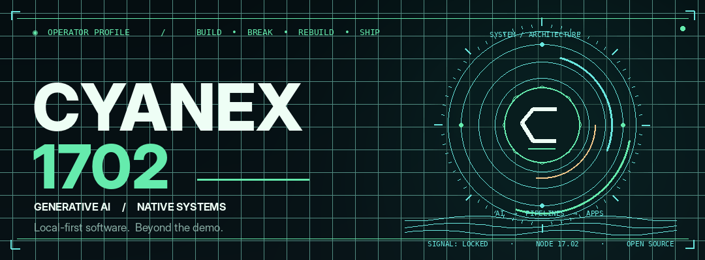
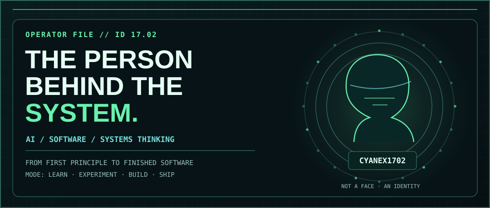
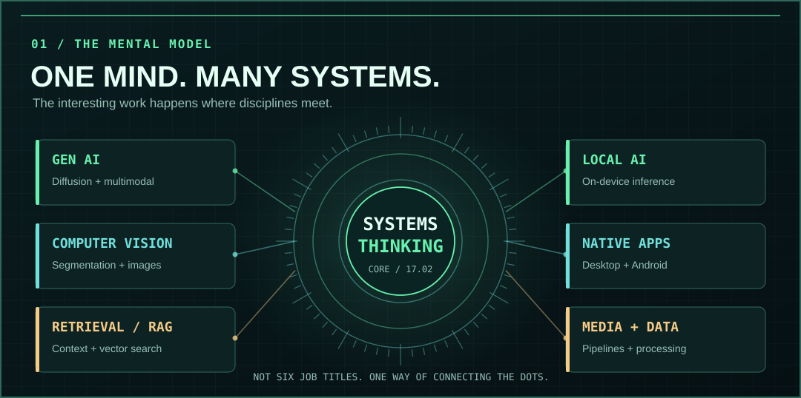
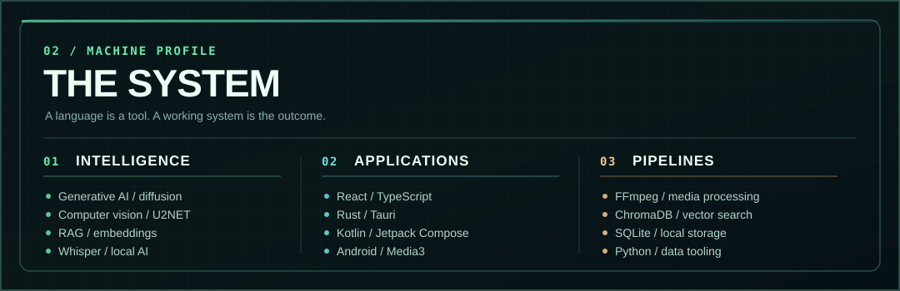
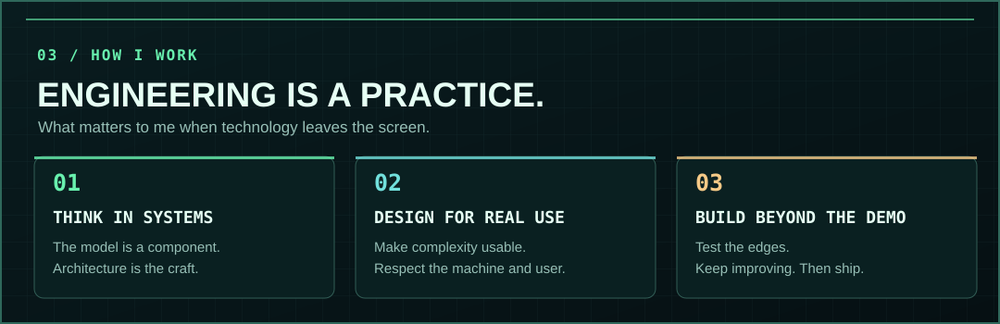
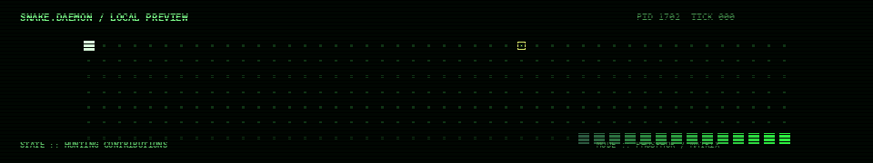
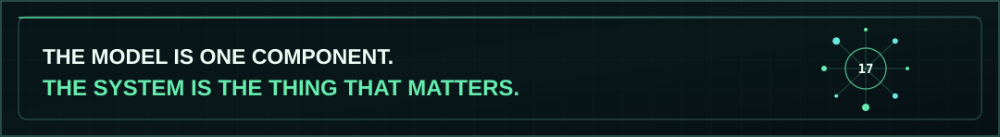

<!-- CYANEX1702 // SIGNAL NOIR · PERSONAL EDITION -->
<!-- An introduction to the person and their technical capabilities — no project showcases. -->

<div align="center">



<br/>

<sub><b>NODE 17.02</b> &nbsp;·&nbsp; AI SYSTEMS &nbsp;·&nbsp; CREATIVE ENGINEERING &nbsp;·&nbsp; LOCAL-FIRST</sub>

<br/><br/>

<a href="#whoami"></a>
<a href="#mindset"></a>
<a href="#specs"></a>
<a href="#principles"></a>
<a href="#signal"></a>

</div>

<a id="whoami"></a>

## `> 00 / WHOAMI`

I’m **CYANEX1702**. I build at the intersection of **generative AI, computer vision, retrieval systems, and native software**. I like understanding the model, but I care just as much about everything around it: interfaces, runtimes, processing pipelines, privacy, and what happens when a system meets the real world.

I’m drawn to software that feels **deliberate, responsive, and useful**—particularly **local-first** tools that don't depend on a cloud round-trip for every action.



```text
cyanex@node-17.02:~$ whoami --verbose

HANDLE        :: CYANEX1702
ROLE          :: AI / SOFTWARE BUILDER
INTERESTS     :: GENERATIVE AI / COMPUTER VISION / RETRIEVAL
PLATFORMS     :: DESKTOP / ANDROID / LOCAL RUNTIMES
MENTAL MODEL  :: UNDERSTAND -> DESIGN -> BUILD -> BREAK -> IMPROVE
OPERATING MODE:: BUILD BEYOND THE DEMO
```

<a id="mindset"></a>

## `> 01 / HOW MY MIND IS WIRED`

I don't see AI, native applications, and data engineering as isolated islands. The part that fascinates me is **connecting them into a single working experience**. A clever model is interesting; a coherent system is what makes it matter.



<a id="specs"></a>

## `> 02 / CAT /PROC/OPERATOR/SPECS`

This is my **technical toolkit**, not a list of products. Tools change; the ability to connect them is the constant.



<details>
<summary><b>↳ EXPAND // FULL TEXT-BASED SPECS</b></summary>

```text
INTELLIGENCE                    APPLICATIONS
├── Generative AI               ├── React / TypeScript
├── Diffusion / inpainting      ├── Rust / Tauri
├── Computer vision / U2NET     ├── Kotlin / Jetpack Compose
├── Retrieval / RAG             ├── Android / Media3
├── Hugging Face / embeddings   └── Native app engineering
└── Whisper / local inference

PROCESSING & STORAGE            DESIGN PRINCIPLES
├── Python                      ├── Local-first
├── FFmpeg                       ├── Privacy-oriented
├── ChromaDB / vector search    ├── Understandable systems
├── SQLite                      └── Build beyond the demo
└── Media / data pipelines
```

</details>

<a id="principles"></a>

## `> 03 / CAT /ETC/PHILOSOPHY`

My favorite kind of engineering turns intimidating technology into something a person can actually use. The code matters. The **choices behind it** matter more.



> **THE MODEL IS ONE COMPONENT. THE SYSTEM IS THE THING THAT MATTERS.**

<a id="signal"></a>

## `> 04 / SIGNAL STILL ALIVE`

<div align="center">



<picture>
  <source media="(prefers-color-scheme: dark)" srcset="./assets/github-snake-dark.svg" />
  <source media="(prefers-color-scheme: light)" srcset="./assets/github-snake.svg" />
  
</picture>

<sub>CODE. LEARN. REFACTOR. REPEAT. &nbsp;//&nbsp; CONTRIBUTION TRACE AUTO-UPDATED BY GITHUB ACTIONS</sub>

</div>

<details>
<summary><b>↳ MAN CYANEX1702 // AN OPERATOR'S MANUAL</b></summary>

```text
NAME
    CYANEX1702 - one builder, several technical obsessions.

SYNOPSIS
    cyanex1702 [--learn] [--build] [--break] [--refine] [--ship]

DESCRIPTION
    Lives somewhere between an AI research paper,
    a native runtime, and an unreasonable number of terminals.

OPTIONS
    --learn     Understand the underlying idea.
    --build     Make it work outside the notebook.
    --break     Find the edge cases before someone else does.
    --refine    Make the next iteration better.
    --ship      Put something useful into the world.

BUGS
    Probably. That's why we test.
```

</details>

<details>
<summary><b>↳ SUDO REVEAL / SECRET PACKET</b></summary>

```text
ACCESS GRANTED.

YOU DIDN'T COME HERE TO READ ANOTHER BUZZWORD LIST.
YOU CAME TO SEE HOW SOMEONE THINKS.

SIGNAL-ID :: 0x1702
CARRIER   :: STABLE
TERMINAL  :: STILL ALIVE
```

</details>

<div align="center">



<br/>

<sub>CURIOUS WHAT I BUILD? &nbsp;·&nbsp; <a href="https://github.com/Cyanex1702?tab=repositories"><b>THE REPOSITORIES TAB HAS THE DETAILS ↗</b></a></sub>

<br/><br/>

<sub>CYANEX1702 &nbsp;·&nbsp; NODE 17.02 &nbsp;·&nbsp; BUILD BEYOND THE DEMO</sub>

</div>
