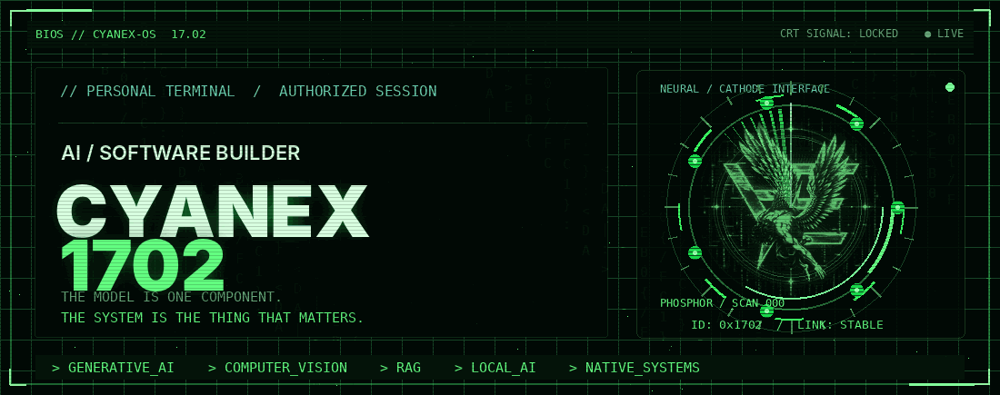
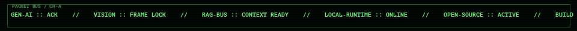
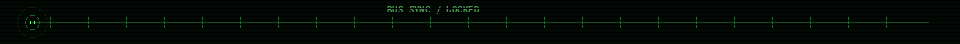
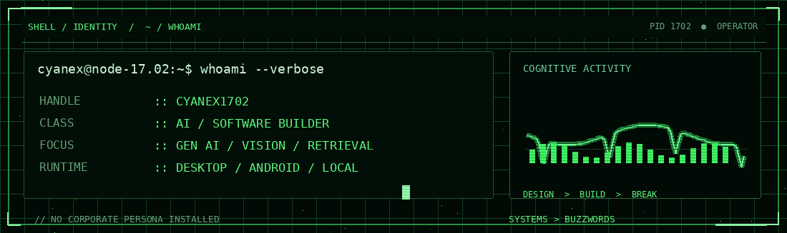
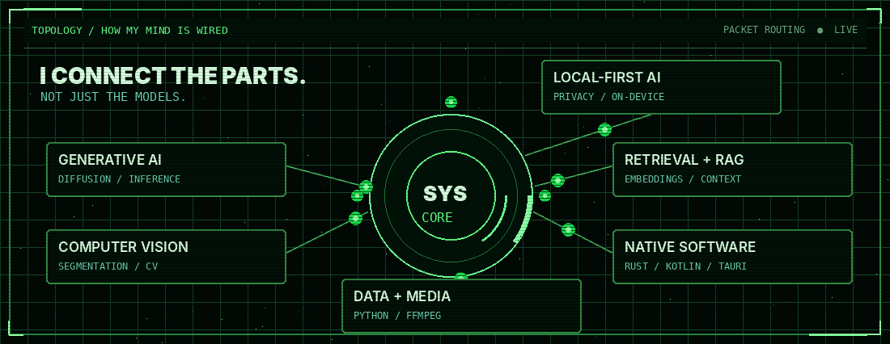
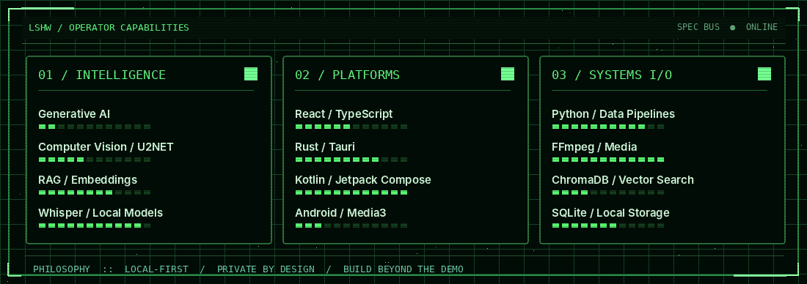

<!--
CYANEX1702 // CATHODE GHOST // PERSONAL TERMINAL PROFILE
No featured repositories. This page is about the operator, not the outputs.
All primary animation is in local GIFs, because GitHub profile READMEs do not run JavaScript.
-->

<div align="center">





<a href="https://git.io/typing-svg"></a>

<br />

<a href="#identity"></a>
<a href="#mind"></a>
<a href="#specs"></a>
<a href="#trace"></a>
<a href="#manual"></a>

<br /><br />

<a href="https://hits.sh/github.com/Cyanex1702/">
  
</a>

</div>



<a id="identity"></a>

## `> 00 / WHOAMI --VERBOSE`



I'm **CYANEX1702**, an AI and software builder obsessed with the space **between the model and the finished system**. I work across generative AI, computer vision, retrieval, local inference, desktop software, and Android. I like software that leaves the notebook, survives real inputs, and stays understandable when something breaks.

> **THE MODEL IS ONE COMPONENT. THE SYSTEM IS THE THING THAT MATTERS.**

<details>
<summary><b>&gt; CAT /ETC/MOTD // PERSONAL OPERATING MESSAGE</b></summary>

```text
WELCOME TO NODE 17.02

NO CORPORATE-PERSONA PACKAGE DETECTED.
NO "10X NINJA ROCKSTAR" MODULE INSTALLED.

I LIKE TO UNDERSTAND THE ENTIRE MACHINE:
THE MODEL, THE RUNTIME, THE DATA, THE UI,
AND THE THINGS THAT GO WRONG OUTSIDE THE DEMO.

MODE  :: BUILD / BREAK / REBUILD / SHIP
BIAS  :: LOCAL-FIRST / PRIVATE / USEFUL
STATE :: STILL BUILDING
```

</details>

<a id="mind"></a>

## `> 01 / CAT /DEV/MIND_BUS`



**My favorite problems live at the intersections.** An AI model needs context; context needs data; data needs pipelines; those pipelines need a runtime and an interface someone actually wants to use. I care about how those parts work **together**.


<a id="specs"></a>

## `> 02 / LSHW --OPERATOR`



<details>
<summary><b>&gt; EXPAND /PROC/SKILLS // TEXT VERSION</b></summary>

```text
INTELLIGENCE                 NATIVE & APPLICATIONS
├─ Generative AI             ├─ React / TypeScript
├─ Diffusion / Inpainting    ├─ Rust / Tauri
├─ Computer Vision / U2NET   ├─ Kotlin / Jetpack Compose
├─ Retrieval / RAG           ├─ Android / Media3
├─ Hugging Face / Embeddings └─ Desktop + Native Apps
└─ Whisper / Local AI

DATA & SIGNAL                ENGINEERING BIAS
├─ Python                    ├─ Local-first
├─ FFmpeg / Media Pipelines  ├─ Privacy-oriented
├─ ChromaDB / Vector Search  ├─ Real-world inputs
├─ SQLite                    ├─ End-to-end thinking
└─ Data Processing           └─ Build beyond the demo
```

</details>

<a id="trace"></a>

## `> 03 / TAIL -F /VAR/LOG/CONTRIBUTIONS`

<div align="center">


<picture>
  <source media="(prefers-color-scheme: dark)" srcset="./assets/github-snake-dark.svg" />
  <source media="(prefers-color-scheme: light)" srcset="./assets/github-snake.svg" />
  
</picture>

<sub>CONTRIBUTION TRACE // REAL GITHUB ACTIVITY // AUTO-REFRESHED SIGNAL</sub>

</div>

<a id="manual"></a>

## `> 04 / MAN CYANEX1702`

<details>
<summary><b>&gt; CYANEX1702(1) // OPERATOR'S MANUAL</b></summary>

```text
NAME
    CYANEX1702 — BUILDS QUESTIONABLE AMOUNTS OF SOFTWARE
    THROUGH TERMINAL-SHAPED INTERFACES.

SYNOPSIS
    CYANEX1702 [--LEARN] [--BUILD] [--BREAK] [--REBUILD] [--SHIP]

DESCRIPTION
    WORKS AT THE INTERSECTION OF GENERATIVE AI, COMPUTER
    VISION, RETRIEVAL, LOCAL AI, DESKTOP, AND ANDROID.

OPTIONS
    --LEARN       UNDERSTAND THE UNDERLYING IDEA.
    --BUILD       MAKE IT WORK OUTSIDE THE NOTEBOOK.
    --BREAK       FIND THE WEAK POINTS.
    --REBUILD     SIMPLIFY THE PART THAT NEVER BELONGED.
    --SHIP        PUT SOMETHING REAL INTO THE WORLD.

BUGS
    PROBABLY. THAT'S WHY WE TEST.

SEE ALSO
    PYTHON(1), RUST(1), KOTLIN(1), CAFFEINE(8)
```

</details>

<details>
<summary><b>&gt; SUDO REVEAL / SECRET PACKET</b></summary>

```text
ACCESS GRANTED.

IF YOU OPENED THIS, YOU DON'T JUST SKIM THE SURFACE.
GOOD. NEITHER DO I.

SIGNAL-ID   :: 0x1702
CARRIER     :: STABLE
TERMINAL    :: STILL ALIVE
```

</details>

<div align="center">


**`NO CARRIER? NEVER.`**

<sub>CYANEX1702  /  NODE 17.02  /  BUILD BEYOND THE DEMO</sub>

<br />

<sub><b>THE TERMINAL STAYS HERE. THE WORK SPEAKS ELSEWHERE.</b></sub>

</div>
